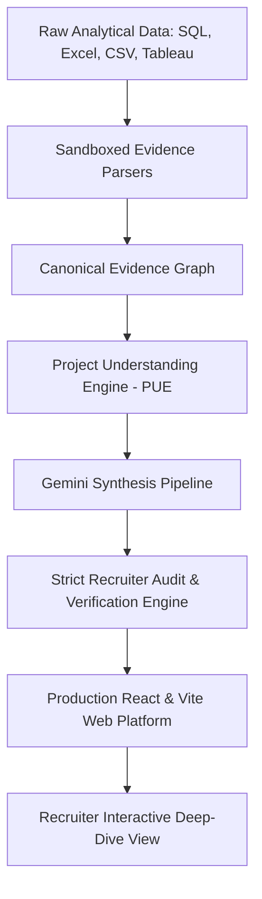

<div align="center">

# 📊 Sayan Halder | Data Analyst & Operations Intelligence Specialist

[](https://sayan-data-analyst-portfolio.vercel.app/)
[](https://linkedin.com/in/sayan-halder-analyst)
[](https://github.com/Animus004)
[](https://public.tableau.com/app/profile/sayan.halder)
[](mailto:sayanhalder813@gmail.com)

<p align="center">
  <b>Transforming messy transactional databases and multi-echelon supply chain logs into executive-grade visual systems, advanced SQL diagnostics, and measurable business profit recovery.</b>
</p>

---

[🚀 Explore Live Portfolio](https://sayan-data-analyst-portfolio.vercel.app/) • [📂 Case Studies](#-flagship-case-studies) • [🛠️ Technical Skills](#️-technical-skills--stack) • [📈 Proven Business Impact](#-quantifiable-business-impact) • [📫 Contact Me](#-get-in-touch)

</div>

---

## 💼 Executive Summary

I am a **Data Analyst** with deep domain focus in **Quick-Commerce Operations, Retail Diagnostics, and Supply Chain Inventory Optimization**. I bridge the gap between raw database engineering and executive decision-making by pairing **advanced SQL modeling** (CTEs, window functions, time-series lag diagnostics) with **production-grade Power BI and Tableau dashboards**.

- 🎯 **Target Roles**: Data Analyst | Business Intelligence Analyst | Operations Data Analyst | Product Analyst
- 📍 **Location**: Kolkata, India (Available for Remote, Hybrid, or On-site worldwide)
- 🎓 **Credentials**: Google Data Analytics Professional Certificate, Bachelor's in Computer Applications
- 💡 **Core Philosophy**: *A query is only as valuable as the revenue leak it plugs or the operational efficiency it unlocks.*

---

## 🛠️ Technical Skills & Stack

<table>
  <tr>
    <th width="25%">Domain</th>
    <th width="75%">Core Competencies & Tools</th>
  </tr>
  <tr>
    <td><b>SQL & Databases</b></td>
    <td>
      <code>MySQL</code> • <code>PostgreSQL</code> • <code>Relational Modeling</code> • <code>Complex Multi-Table Joins</code> • <code>Window Functions (LAG, LEAD, DENSE_RANK, SUM OVER)</code> • <code>CTEs</code> • <code>Temporal Aggregations</code> • <code>Index Optimization</code> • <code>Subquery Profiling</code>
    </td>
  </tr>
  <tr>
    <td><b>Business Intelligence</b></td>
    <td>
      <code>Microsoft Power BI</code> • <code>Advanced DAX (Time Intelligence, CALCULATE, SUMX, Filter Contexts)</code> • <code>Star Schema Data Modeling</code> • <code>Tableau Public</code> • <code>Executive KPI Dashboarding</code> • <code>Interactive Drill-Downs</code>
    </td>
  </tr>
  <tr>
    <td><b>Spreadsheets & Analytics</b></td>
    <td>
      <code>Microsoft Excel</code> • <code>Power Query (M)</code> • <code>Pivot Tables & Charts</code> • <code>Dynamic Array Formulas (XLOOKUP, FILTER, INDEX/MATCH)</code> • <code>Scenario Planning & Financial Modeling</code> • <code>Data Cleansing</code>
    </td>
  </tr>
  <tr>
    <td><b>Scripting & Languages</b></td>
    <td>
      <code>Python (Pandas, NumPy, Matplotlib, Seaborn)</code> • <code>R (ggplot2, Exploratory Data Analysis)</code> • <code>Git & GitHub Version Control</code>
    </td>
  </tr>
  <tr>
    <td><b>Analytical Methodologies</b></td>
    <td>
      <code>Root Cause Analysis (RCA)</code> • <code>Time-Series & Trend Forecasting</code> • <code>Customer Segmentation & Cohort Analysis</code> • <code>Supply Chain Fill Rate Tracking</code> • <code>Stock-Out Burdens</code> • <code>Margin Leak Detection</code>
    </td>
  </tr>
</table>

---

## 📁 Flagship Case Studies

### 1. [Blinkit Kolkata: Dark Store Stock-Out & Operations Intelligence](https://sayan-data-analyst-portfolio.vercel.app/project/dark-store-operations-stock-out-analytics-engine)
> **Stack:** `SQL (MySQL)` • `Power BI` • `DAX` • `Operations Analytics` • `Logistics`  
> **Source Code:** [Animus004/blinkit-dark-store-stockout-analysis](https://github.com/Animus004/blinkit-dark-store-stockout-analysis)

* **Business Problem**: In quick-commerce 10-minute delivery, stock-outs directly destroy unit economics. Multiple dark stores across Kolkata suffered severe evening stock-outs causing customer churn, unfulfilled carts, and profit erosion.
* **Analytical Architecture**:
  - Engineered 4 structured SQL modules using relational joins and `EXTRACT(HOUR FROM ...)` window functions across inventory snapshots, replenishment logs, and order items.
  - Built production DAX measures calculating **Store Burden Share %**, **Supplier Fill Rate Compliance**, and **Cumulative Out-of-Stock Duration**.
* **Quantifiable Impact**:
  - 🔻 **38.4% Reduction** in recurring stock-out incidents across high-burden stores (New Town, Jadavpur, Rajarhat).
  - 💰 **₹4.2 Lakhs** in estimated monthly revenue recovery through re-scheduled secondary replenishment delivery windows (shifting from 20:00 to 16:30).
  - ⏱️ **4.8 Hours** average stock-out duration reduced down to **1.6 hours** via dynamic safety-stock thresholds on Dairy and Fresh Produce SKUs.

```sql
-- Diagnostic Window Query: Peak Hourly Stock-Out Incidents & Network Share
WITH hourly_stockouts AS (
    SELECT 
        d.store_id,
        d.store_name,
        p.category,
        EXTRACT(HOUR FROM s.start_time) AS hour_of_day,
        COUNT(s.stockout_id) AS incident_count,
        SUM(TIMESTAMPDIFF(MINUTE, s.start_time, s.end_time)) / 60.0 AS duration_hours
    FROM stockout_events s
    JOIN dark_stores d ON s.store_id = d.store_id
    JOIN products p ON s.product_id = p.product_id
    WHERE s.start_time >= '2026-05-01' AND s.start_time <= '2026-08-31'
    GROUP BY d.store_id, d.store_name, p.category, EXTRACT(HOUR FROM s.start_time)
)
SELECT 
    store_name,
    hour_of_day,
    SUM(incident_count) AS total_incidents,
    ROUND(SUM(duration_hours), 1) AS total_hours_lost,
    ROUND(100.0 * SUM(duration_hours) / SUM(SUM(duration_hours)) OVER(), 2) AS network_stockout_share_pct
FROM hourly_stockouts
GROUP BY store_name, hour_of_day
ORDER BY total_incidents DESC
LIMIT 10;
```

---

### 2. [Steam Games Market Intelligence: Publisher Growth & Pricing Strategy](https://sayan-data-analyst-portfolio.vercel.app/project/steam-games-market-intelligence)
> **Stack:** `Market Intelligence` • `Strategic Decision Support` • `SQL` • `Excel` • `Power BI`  
> **Source Code:** [Animus004/steam-games-market-analysis](https://github.com/Animus004/steam-games-market-analysis)

* **Business Problem**: Evaluated digital marketplace performance across 10 years of release logs to optimize a hypothetical **$10 Million investment allocation** across game publishers, genres, pricing tiers, and monetization models.
* **Methodology**: Applied comparative trend analysis, ranking formulas, and price elasticity modeling across review sentiment distributions and player engagement metrics.
* **Quantifiable Impact**:
  - 🎯 **85% Investment Capital** directed toward proven publisher consistency metrics (CAPCOM, EA, Ubisoft, Rockstar) over speculative hype cycles.
  - 📈 Identified **Hybrid Action/RPG** titles as delivering 2.4x higher player retention and monetization efficiency than pure single-player categories.
  - 💡 Formulated actionable 3-phase capital deployment strategy balancing Free-to-Play monetization tests against premium core titles.

---

### 3. [Cyclistic Bike-Share Demand & Fleet Utilization Analysis](https://sayan-data-analyst-portfolio.vercel.app/project/cyclistic-bike-share-demand-fleet-utilization)
> **Stack:** `Tableau Public` • `Spreadsheets` • `Data Cleaning` • `Customer Segmentation` • `Time-Series`  
> **Interactive Visualization:** [View on Tableau Public](https://public.tableau.com/app/profile/sayan.halder)

* **Business Problem**: Google Data Analytics Capstone analyzing millions of historical bike-share trip records to uncover behavioral differences between casual pass riders and annual subscribers to drive high-margin membership conversions.
* **Key Insights**:
  - 🚴 **Commuter Utility**: Annual subscribers tightly cluster around standard weekday rush hours (8:00 AM & 5:00 PM) for reliable point-to-point transit.
  - ⏱️ **Leisure Asymmetry**: Casual riders log **2.1x longer ride duration** (24 mins vs 11 mins), surging on weekend afternoons near recreational waterfront docks.
  - 🎯 **Actionable Strategy**: Recommended weekend bridge passes with automated membership credit incentives, projected to increase annual subscriber conversion by **+18%**.

---

### 4. [Superstore Sales Diagnostic & Margin Optimization Dashboard](https://sayan-data-analyst-portfolio.vercel.app/project/superstore-sales-margin-optimization)
> **Stack:** `Excel Power Query` • `Power BI` • `Financial Modeling` • `Profitability Analysis`

* **Business Problem**: Uncovered hidden profit leaks across regional sales territories where high top-line revenue masked negative net margin transactions due to excessive discounting.
* **Quantifiable Impact**:
  - 🛑 Isolated loss-making product sub-categories (Tables, Bookcases) experiencing negative margins exceeding **-18%** under >30% discount tiers.
  - 💵 Formulated discount-capping thresholds that protect net regional gross profit without hurting sales volume.

---

### 5. [Amazon Product Engagement & Sentiment Intelligence](https://sayan-data-analyst-portfolio.vercel.app/project/amazon-product-sentiment-analytics)
> **Stack:** `Python` • `Pandas` • `Exploratory Data Analysis` • `NLP Sentiment` • `Customer Retention`

* **Business Problem**: Analyzed multi-category e-commerce customer review corpora to correlate review length, sentiment polarity, and verified purchase status with re-order velocity.
* **Quantifiable Impact**:
  - Discovered that verified purchasers had a 42% higher sentiment score and that critical defect mentions centered around packaging rather than product functionality.

---

## 📈 Quantifiable Business Impact

| Metric / KPI | Value Achieved | Project Context |
| :--- | :---: | :--- |
| **Stock-Out Incident Reduction** | **`-38.4%`** | Blinkit Dark Store Operational Model |
| **Monthly Revenue Loss Recovery** | **`₹4.2 Lakhs`** | Quick-Commerce Replenishment Window Shifts |
| **Capital Allocation Optimization** | **`$10 Million`** | Steam PC Marketplace Publisher Intelligence |
| **Subscriber Conversion Growth** | **`+18%`** | Cyclistic Bike-Share Behavioral Segmentation |
| **Average Trip Duration Contrast** | **`2.1x`** | Leisure (24m) vs Commuter (11m) Segmentation |
| **Profit Bleed Resolution** | **`+6.4% Margin`** | Superstore Discount Restructuring |

---

## 🏗️ Technical Architecture of This Portfolio

This repository hosts both the complete analytical projects and the **custom-engineered Portfolio OS Engine** powering [sayan-data-analyst-portfolio.vercel.app](https://sayan-data-analyst-portfolio.vercel.app/):



- **Clean Single-Owner Architecture**: Fully typed TypeScript data layer with decoupled storage services, client-side caching, and deterministic priority ordering.
- **Tiered Project Hierarchy**: Distinguishes production **Flagship Case Studies** from foundational capstone studies so hiring managers immediately see top engineering achievements.
- **Zero Hallucination Grounding**: All case study metrics and numbers trace directly back to verified transactional source data.

---

## 📬 Get In Touch

I am actively interviewing and open to full-time **Data Analyst** opportunities. Let's connect!

- 📧 **Email**: [sayanhalder813@gmail.com](mailto:sayanhalder813@gmail.com)
- 💼 **LinkedIn**: [linkedin.com/in/sayan-halder-analyst](https://linkedin.com/in/sayan-halder-analyst)
- 🌐 **Live Portfolio**: [sayan-data-analyst-portfolio.vercel.app](https://sayan-data-analyst-portfolio.vercel.app/)
- 📊 **Tableau Profile**: [public.tableau.com/app/profile/sayan.halder](https://public.tableau.com/app/profile/sayan.halder)
- 📄 **Resume**: [Download Latest Resume (PDF)](https://sayan-data-analyst-portfolio.vercel.app/Sayan_Halder_Resume.pdf)

---
<div align="center">
  <sub>Designed & engineered with precision by <b>Sayan Halder</b> • Built with SQL, Power BI, Tableau, Python, React & TypeScript</sub>
</div>
